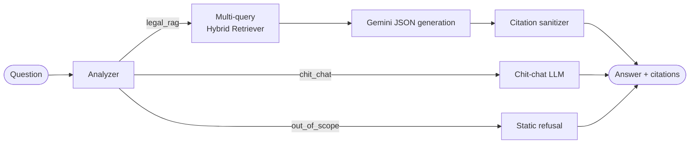

# Law-on-Marriage-and-Family-Chatbot

An agentic RAG system for Vietnamese Marriage & Family Law. It uses structure-aware legal chunking, hybrid retrieval (dense + BM25 with RRF), and citation-grounded answers tied to specific **Điều / Khoản / Điểm**.

**Live demo:** <https://marriage-chatbot.streamlit.app/>

## Features

- **Hierarchy-aware chunking**: a custom `.docx` parser splits statutes by Chương → Mục → Điều → Khoản → Điểm and embeds parent context (article title + clause lead-in) into each leaf chunk.
- **Hybrid retrieval**: `multilingual-e5-base` on Qdrant plus BM25 (`pyvi` segmentation), fused with Reciprocal Rank Fusion.
- **Legal-aware expansion**: sibling-clause expansion, `khoản X Điều Y` cross-reference resolution, and per-article diversification.
- **Multi-query retrieval**: an LLM analyzer rewrites each question into a standalone query plus 3 legal-terminology expansions; results are merged and deduplicated.
- **Agentic routing (LangGraph)**: `legal_rag`, `chit_chat`, or `out_of_scope` (static refusal, no LLM call).
- **Anti-hallucination**: strict prompt, JSON output with a separate `citations` field, and post-hoc citation validation against the retrieved context.
- **Multi-turn memory**: per-thread state via `SqliteSaver`, with resolution of references such as "my first question".
- **Resilient LLM client**: multi-key round-robin, model fallback, and exponential backoff.

## Architecture



**Retriever pipeline (per query):**
dense top-20 + BM25 top-20 → RRF (k=60) → top-10 → sibling expansion (±1 Khoản) → cross-reference resolution → diversification (max 3 hits per Điều).
Results from all expanded queries are merged by summing RRF scores, then capped at 20 chunks.

## Tech Stack

LangGraph · Google Gemini (`google-genai`) · Qdrant (embedded) · sentence-transformers · rank_bm25 · pyvi · python-docx · Streamlit

## Project Structure

```
agent/        analyzer, graph, legal_rag, chit_chat, out_of_scope
config/       documents.yaml (corpus manifest + parsing rules)
data/         raw/ (.docx), processed/ (chunks), qdrant_db/, bm25_cache.pkl
generation/   legal_answer_generator.py
indexing/     dense_index.py, BM25_cache.py
processing/   legal_splitter.py
retrieval/    hybrid_retriever.py
llm_client.py
run_all_chunking.py
streamlit_app.py
```

## Getting Started

**Requirements:** Python 3.11 and a Gemini API key.

```bash
git clone https://github.com/epsilon-thieu/Law-on-Marriage-and-Family-Chatbot.git
cd Law-on-Marriage-and-Family-Chatbot
pip install -r requirements.txt
```

Create `.env`:

```env
GOOGLE_API_KEY=your_key
GOOGLE_API_KEY_2=optional_second_key
```

Build the data layer (skip if `data/` is already populated):

```bash
python run_all_chunking.py        # .docx -> data/processed/all_chunks.jsonl
python indexing/dense_index.py    # Qdrant dense index
python indexing/BM25_cache.py     # BM25 index
```

Run:

```bash
streamlit run streamlit_app.py    # web UI
python agent/graph.py             # CLI chat
```

> If you change the embedding model or chunking logic, rebuild **both** indexes.

## Knowledge Base

15 documents listed in `config/documents.yaml`: the Law on Marriage and Family 2014, Decrees 126/2014, 82/2020, 207/2025, 19/2011 and 110/2013, Resolutions 01/2024/NQ-HĐTP and 326/2016, Circulars 32/2016, 34/2017 and 01/2016 (joint), plus related laws. To add a document, put the `.docx` in `data/raw/`, add an entry to `documents.yaml`, and rebuild the indexes.

## Limitations & Roadmap

- No reranker yet (planned: cross-encoder reranking)
- Amended vs. superseded provisions are not modeled by effective date
- `web_search` category is routed to the out-of-scope refusal
- Evaluation covers retrieval only (Recall@10); automated faithfulness evaluation is planned
- Planned: contrastive fine-tuning of the dense retriever, HyDE, GraphRAG for cross-references

## Disclaimer

For informational purposes only. This is not legal advice; verify against official current legal texts.
