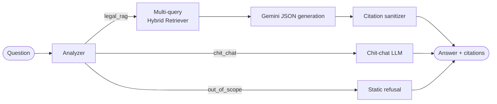

# Law-on-Marriage-and-Family-Chatbot

An agentic RAG system for Vietnamese Marriage & Family Law. It uses structure-aware legal chunking, hybrid retrieval (dense + BM25 with RRF), and citation-grounded answers tied to specific **Điều / Khoản / Điểm**.

**Live demo:** <https://marriage-chatbot.streamlit.app/>


## Architecture



**Retriever pipeline (per query):**
dense top-20 + BM25 top-20 → RRF (k=60) → top-10 → sibling expansion (±1 Khoản) → cross-reference resolution → diversification (max 3 hits per Điều).
Results from all expanded queries are merged by summing RRF scores, then capped at 20 chunks.

## Architecture Components & Functions

The system is divided into several specialized modules working in tandem:

### 1. Offline Data Pipeline (Ingestion & Indexing)
*   **PDF Processing & Cleaning:** Uses `pdfplumber` and custom regex scripts to extract and clean text from 24 active legal PDFs (Laws, Decrees, Circulars), removing headers/footers and fixing broken layouts.
*   **Hierarchical Splitter (v6):** A custom chunking strategy that respects legal boundaries. Instead of fixed token limits, it chunks text by **Article $\rightarrow$ Clause $\rightarrow$ Point**, automatically prepending the opening sentence of a Clause to its subsequent Points to preserve penalty contexts.
*   **Indexer:** Converts the 4,423 generated chunks into vector embeddings using the `intfloat/multilingual-e5-base` model.

### 2. Storage
*   **Qdrant Vector DB:** Stores the dense vector embeddings (768 dimensions) of the legal chunks for semantic similarity search.
*   **BM25 Cache:** Stores sparse representations of the chunks to enable exact keyword matching (crucial for specific document numbers like "168/2024/NĐ-CP").
*   **Checkpointer (SqliteSaver):** Manages state memory for the LangGraph agents, tracking thread IDs to maintain conversational context.

### 3. Traffic Hybrid Retriever
*   **Dense & Sparse Retrieval:** Executes parallel searches using cosine similarity (E5-base) for semantic meaning and BM25 for precise Vietnamese keyword matching.
*   **RRF Fusion:** Merges the results from both retrieval methods using Reciprocal Rank Fusion to leverage the strengths of both approaches.
*   **Context Enrichment (Sibling $\pm 2$ & Cross-ref):** Automatically fetches neighboring clauses and traces legal cross-references (e.g., "according to Clause X, Article Y") to ensure the LLM receives the complete legal context.

### 4. User Interface & API
*   **Frontend (Next.js 14):** Provides the chat interface and an admin dashboard. It handles streaming responses via Server-Sent Events (SSE) for smooth user experience.
*   **Backend (FastAPI):** Acts as the API gateway, managing routing, state resumption, and telemetry metrics.

### 5. LangGraph Agent (Orchestration)
*   **Analyzer & Router:** Evaluates the user's query intent and routes it to one of four specific workflows: `legal_rag` (for law questions), `chit_chat` (for conversational queries), `out_of_scope` (for irrelevant topics), or `web_search` (fallback for missing data).
*   **Human-In-The-Loop (HITL):** When the `web_search` route is triggered, the system halts via an `interrupt_before` node, requiring an admin to review and approve the web-sourced answer before it is finalized and sent to the user.

### 6. Generation (Legal Answer Generator)
*   **LLM (Google Gemini 1.5 Flash Lite):** Generates the final response based *only* on the retrieved context.
*   **Strict Prompting & Sanitation:** Constrained by a 15-rule system prompt preventing any external inference. A post-processing step strictly verifies every citation against the retrieved chunks, stripping out any hallucinated legal references before delivery.## Architecture Components & Functions

The system is divided into several specialized modules working in tandem:

### 1. Offline Data Pipeline (Ingestion & Indexing)
*   **PDF Processing & Cleaning:** Uses `pdfplumber` and custom regex scripts to extract and clean text from 24 active legal PDFs (Laws, Decrees, Circulars), removing headers/footers and fixing broken layouts.
*   **Hierarchical Splitter (v6):** A custom chunking strategy that respects legal boundaries. Instead of fixed token limits, it chunks text by **Article $\rightarrow$ Clause $\rightarrow$ Point**, automatically prepending the opening sentence of a Clause to its subsequent Points to preserve penalty contexts.
*   **Indexer:** Converts the 4,423 generated chunks into vector embeddings using the `intfloat/multilingual-e5-base` model.

### 2. Storage
*   **Qdrant Vector DB:** Stores the dense vector embeddings (768 dimensions) of the legal chunks for semantic similarity search.
*   **BM25 Cache:** Stores sparse representations of the chunks to enable exact keyword matching (crucial for specific document numbers like "168/2024/NĐ-CP").
*   **Checkpointer (SqliteSaver):** Manages state memory for the LangGraph agents, tracking thread IDs to maintain conversational context.

### 3. Traffic Hybrid Retriever
*   **Dense & Sparse Retrieval:** Executes parallel searches using cosine similarity (E5-base) for semantic meaning and BM25 for precise Vietnamese keyword matching.
*   **RRF Fusion:** Merges the results from both retrieval methods using Reciprocal Rank Fusion to leverage the strengths of both approaches.
*   **Context Enrichment (Sibling $\pm 2$ & Cross-ref):** Automatically fetches neighboring clauses and traces legal cross-references (e.g., "according to Clause X, Article Y") to ensure the LLM receives the complete legal context.

### 4. User Interface & API
*   **Frontend (Next.js 14):** Provides the chat interface and an admin dashboard. It handles streaming responses via Server-Sent Events (SSE) for smooth user experience.
*   **Backend (FastAPI):** Acts as the API gateway, managing routing, state resumption, and telemetry metrics.

### 5. LangGraph Agent (Orchestration)
*   **Analyzer & Router:** Evaluates the user's query intent and routes it to one of four specific workflows: `legal_rag` (for law questions), `chit_chat` (for conversational queries), `out_of_scope` (for irrelevant topics), or `web_search` (fallback for missing data).
*   **Human-In-The-Loop (HITL):** When the `web_search` route is triggered, the system halts via an `interrupt_before` node, requiring an admin to review and approve the web-sourced answer before it is finalized and sent to the user.

### 6. Generation (Legal Answer Generator)
*   **LLM (Google Gemini 1.5 Flash Lite):** Generates the final response based *only* on the retrieved context.
*   **Strict Prompting & Sanitation:** Constrained by a 15-rule system prompt preventing any external inference. A post-processing step strictly verifies every citation against the retrieved chunks, stripping out any hallucinated legal references before delivery.

## Tech Stack

LangGraph · Google Gemini (`google-genai`) · Qdrant (embedded) · sentence-transformers · rank_bm25 · pyvi · python-docx · Streamlit

## INSTALL

**Requirements:** Python 3.11 and a Gemini API key.

```bash
git clone https://github.com/epsilon-thieu/Law-on-Marriage-and-Family-Chatbot.git
cd Law-on-Marriage-and-Family-Chatbot
pip install -r requirements.txt
```

Create `.env`:

```env
GOOGLE_API_KEY=your_key
GOOGLE_API_KEY_2=optional_second_key
```

Build the data layer (skip if `data/` is already populated):

```bash
python run_all_chunking.py        # .docx -> data/processed/all_chunks.jsonl
python indexing/dense_index.py    # Qdrant dense index
python indexing/BM25_cache.py     # BM25 index
```

Run:

```bash
streamlit run streamlit_app.py    # web UI
python agent/graph.py             # CLI chat
```

> If you change the embedding model or chunking logic, rebuild **both** indexes.

## Knowledge Base

15 documents listed in `config/documents.yaml`: the Law on Marriage and Family 2014, Decrees 126/2014, 82/2020, 207/2025, 19/2011 and 110/2013, Resolutions 01/2024/NQ-HĐTP and 326/2016, Circulars 32/2016, 34/2017 and 01/2016 (joint), plus related laws. To add a document, put the `.docx` in `data/raw/`, add an entry to `documents.yaml`, and rebuild the indexes.

## Results & Evaluation

The system was rigorously benchmarked using 40 real-world legal scenarios across 10 controlled experiments:

*   **Retrieval Performance (Recall@10):** Achieved **0.581**, a 2.9x improvement over standard fixed-length chunking.
*   **Routing Accuracy:** **97.5%** accuracy in correctly identifying and routing user intent.
*   **Citation Accuracy:** Increased by **8.7x** (scoring 0.279) thanks to the strict prompting and citation sanitation pipeline compared to baseline LLM performance.
*   **Cost Efficiency:** Highly optimized, costing approximately **~$0.0034 per query**.
*   **Identified Bottleneck (Context Coverage):** Currently at **0.452**. This indicates that while answers are accurate, complex queries requiring multi-document reasoning still miss some peripheral context. Future upgrades will implement GraphRAG to map these cross-references explicitly.## Results & Evaluation

The system was rigorously benchmarked using 40 real-world legal scenarios across 10 controlled experiments:

*   **Retrieval Performance (Recall@10):** Achieved **0.581**, a 2.9x improvement over standard fixed-length chunking.
*   **Routing Accuracy:** **97.5%** accuracy in correctly identifying and routing user intent.
*   **Citation Accuracy:** Increased by **8.7x** (scoring 0.279) thanks to the strict prompting and citation sanitation pipeline compared to baseline LLM performance.
*   **Cost Efficiency:** Highly optimized, costing approximately **~$0.0034 per query**.
*   **Identified Bottleneck (Context Coverage):** Currently at **0.452**. This indicates that while answers are accurate, complex queries requiring multi-document reasoning still miss some peripheral context. Future upgrades will implement GraphRAG to map these cross-references explicitly.
